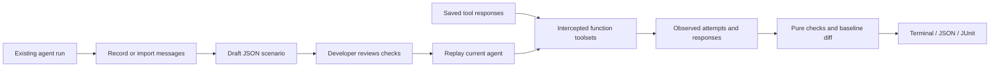

# Architecture and safety boundary

The package keeps three concerns separate:

1. **Artifacts and policies** are strict JSON models and pure functions. They can be inspected and unit tested without Pydantic AI or a model provider.
2. **Framework adaptation** extracts message traces and replaces the tool execution boundary while preserving the tools' argument schemas and descriptions.
3. **Execution and presentation** handle repeats, concurrency, timeouts, assertion results, terminal output, and machine-readable reports.

## Record

Recording runs the configured agent and captures its messages. Its configured tools execute. Use a harmless local agent, a controlled staging environment, or import already captured messages if tools may have side effects. Recording is deliberately distinct from replay. Recording never marks expectations reviewed.

For the first version, traces contain JSON-compatible arguments and responses, and final output is text. Responses use framework-compatible JSON serialization; unsupported objects fail artifact creation instead of being silently stringified. Tool retry messages are retained. Prompt, fixture content, and final output may contain sensitive data; sanitize them before committing scenarios.

## Replay

Pydantic AI's public override and wrapper-toolset APIs preserve the current agent's instructions, tool descriptions, schemas, dependency type, and model. The wrapped toolset returns saved responses instead of invoking tool functions. Missing fixtures fail closed. Argument validation stays in the framework, while message extraction captures attempted calls to enforce policies even when arguments are invalid.

The initial dependency range is Pydantic AI `>=2.55,<2.56`; this narrows integration changes while the API is young. Tests use FunctionModel so CI does not require provider credentials. Pydantic AI's official [testing guide](https://pydantic.dev/docs/ai/guides/testing/) documents FunctionModel and model overrides.

Only supported in-process function toolsets and text output are accepted. Unsupported provider-native tools, custom capabilities, dynamic/remote toolsets, deferred calls, and structured outputs are rejected before replay. The runner is **not a Python sandbox**: imported agent factories, dynamic prompts, hooks, validators, dependencies, tool prepare callbacks, and provider requests can execute ordinary application code. Those must be trusted and configured appropriately. Replay's guarantee covers intercepted function-tool bodies; it cannot prevent arbitrary application code from making requests itself.

## Evaluation

Policies inspect **attempts**, not only successful tool results. A forbidden refund fails even if the refund fixture is absent. An argument mismatch is visible even if schema validation rejects that argument. Required calls count attempts; replay errors still fail the run separately. Ordering additionally requires a successful prerequisite in a previous model turn.

Saved responses match exact arguments and are consumed per run. Each repeated run starts with fresh fixture state; concurrent tasks isolate their override contexts and queues. A bounded timeout and request budget prevent an accidental model loop from running indefinitely. A configured live model can still incur costs before those limits; deterministic tests make no provider requests.

Failure rates are descriptive counts such as `failed 3 of 10 runs`. They do not imply independent statistical samples or guarantee a future failure probability. An offline scripted model verifies package behavior, not real-model instruction following.

## Supported release workflow

Develop locally, validate with pytest/Ruff/mypy, build wheel and sdist, and install the wheel in a fresh environment. The prepared GitHub workflow tests Python 3.11–3.13 and runs reviewed example scenarios on pull requests. This repository has no configured remote or publishing step. Future real-model validation and user pilots are described in the [project plan](PROJECT_PLAN.md).
